# Deploying and Configuring an Azure Application Gateway with Content-Based Routing

Comprehensive documentation detailing the deployment of an Azure Application Gateway (`appgateway`) in the East US region configured with backend pools, public IP frontends, and path-based routing rules. The setup directs incoming HTTP traffic to designated backend Windows virtual machines (`vm1` and `vm2`) hosting tailored web applications (`Images Server` and `Videos Server`).

---

## 1. Architecture & Provisioned Resources

### Core Infrastructure Topology

| Resource Type | Resource Name | Specification / Tier | Region / Location |
| :--- | :--- | :--- | :--- |
| **Application Gateway** | `appgateway` | Standard V2 Tier, Zones 1, 2, 3 | East US[cite: 59] |
| **Frontend Public IP** | `gatewayip` | Static Standard IPv4 (`40.121.122.178`) | East US[cite: 59] |
| **Virtual Network** | `net1` | Address Space: `10.1.0.0/16` | East US[cite: 63] |
| **Virtual Machine 1** | `vm1` | Standard B2s, Windows Server 2025 Datacenter | East US[cite: 64] |
| **Virtual Machine 2** | `vm2` | Standard B2s, Windows Server 2025 Datacenter | East US[cite: 64] |
| **Network Security Group** | `vm1-nsg` | Attached to backend virtual machine interfaces | East US[cite: 64] |

---

### Provisioned Environment Validation

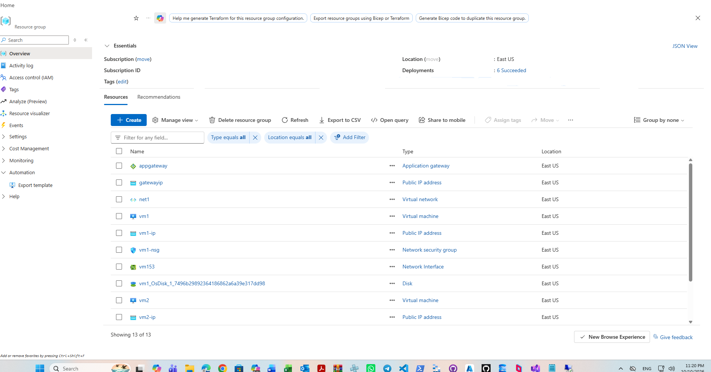

*Resource group inventory confirming successful provisioning of the Application Gateway, frontend IP, virtual network, and backend virtual machines.*

---

## 2. Step-by-Step Implementation

### Step 1: Inspect Virtual Network Configuration

Reviewed the core virtual network layout (`net1`) to verify address space allocation and subnet configurations designed to support Application Gateway and backend compute tiers.

* **Virtual Network:** `net1`
* **Address Space:** `10.1.0.0/16`
* **Subnets Configured:** 2 Subnets (including dedicated Application Gateway and backend pool subnets)

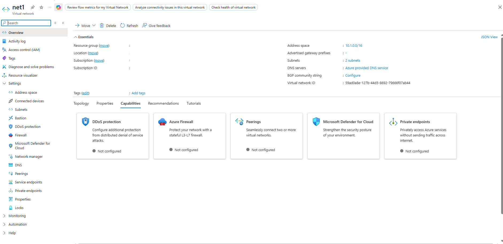

*Reviewing essentials and parameters for virtual network net1.*

---

### Step 2: Deploy and Verify Application Gateway

Provisioned the Layer 7 load balancer (`appgateway`) within the gateway subnet, attaching a static public frontend IP and confirming zone redundancy.

* **Gateway Name:** `appgateway`[cite: 59]
* **Tier:** Standard V2[cite: 59]
* **Frontend Public IP:** `40.121.122.178` (`gatewayip`)[cite: 59]
* **Availability Zones:** 1, 2, 3[cite: 59]

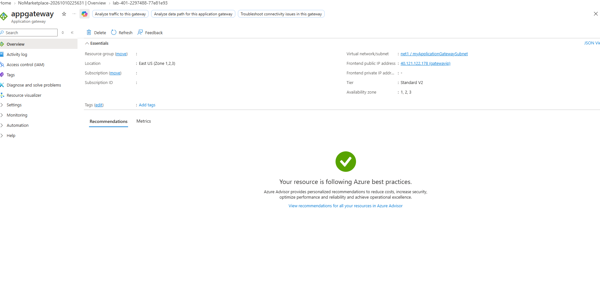

*Confirming deployment success, tier properties, and public frontend IP binding for appgateway.*

---

### Step 3: Install Internet Information Services on Backend VMs

Configured the backend compute instances (`vm1` and `vm2`) by establishing Remote Desktop sessions and installing the Web Server (IIS) role components.

* **Target Instances:** `vm1` and `vm2`[cite: 64]
* **Role Installed:** Web Server (IIS)
* **Status:** Running and reachable

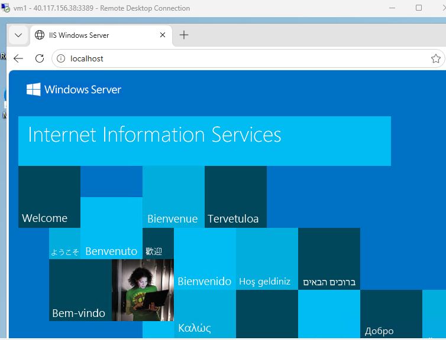

*Validating the default IIS landing page on vm1.*

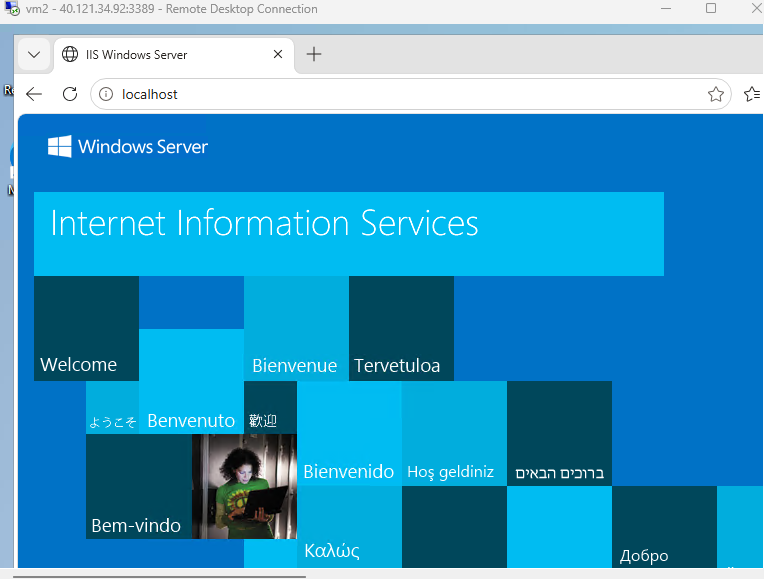

*Validating the default IIS landing page on vm2.*

---

### Step 4: Configure Server Web Content

Customized the default web server directories on each backend instance to host dedicated content paths for content-based routing demonstration.

* **Virtual Machine 1 (`vm1`):** Configured content directory hosting `Images Server` profile.
* **Virtual Machine 2 (`vm2`):** Configured content directory hosting `Videos Server` profile.

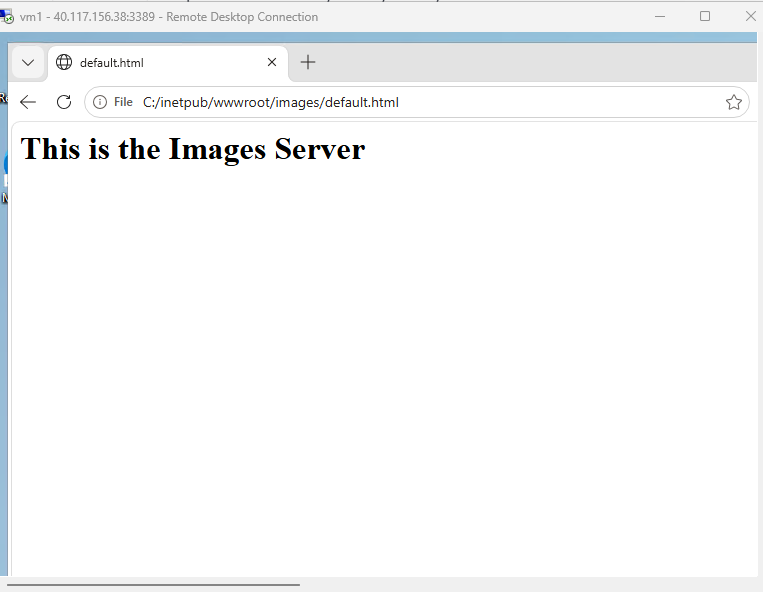

*Local file path check confirming the deployed Images Server index content.*

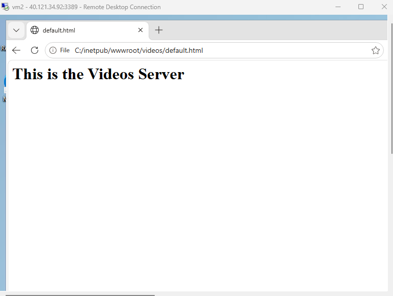

*Local file path check confirming the deployed Videos Server index content.*

---

### Step 5: Verify Backend Virtual Machine Properties

Inspected the backend virtual machine properties in the Azure Portal to confirm runtime allocation, sizing, and network binding for both instances.

* **Virtual Machine 1 Details:** `vm1` bound to `net1/myBackendPool` subnet with private IP `10.1.0.4` and public IP `40.117.156.38`.
* **Virtual Machine 2 Details:** `vm2` bound to `net1/myBackendPool` subnet with private IP `10.1.0.5`.

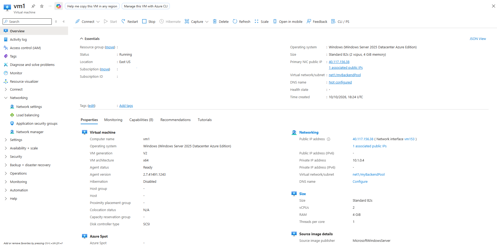

*Inspecting properties, private/public IP bindings, and network settings for vm1.*

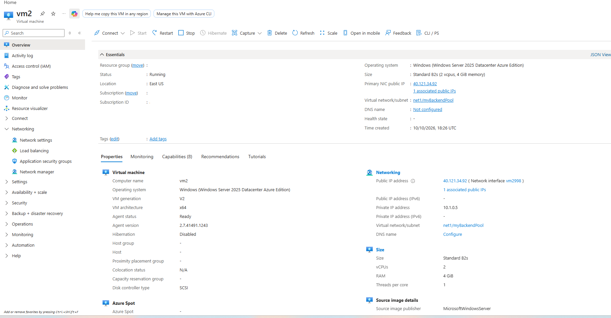

*Inspecting properties, private/public IP bindings, and network settings for vm2.*

---

### Step 6: Validate Application Gateway Routing Endpoints

Tested end-to-end path-based routing through the Application Gateway frontend IP to ensure client requests correctly reach the respective backend pools.

* **Images Path Routing:** `http://40.121.122.178/images/Default.html` routes to `vm1` backend pool.
* **Videos Path Routing:** `http://40.121.122.178/videos/Default.html` routes to `vm2` backend pool.

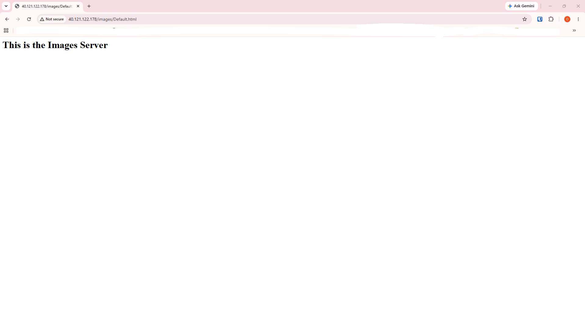

*Browser validation confirming HTTP traffic routed successfully to the Images Server via Application Gateway.*

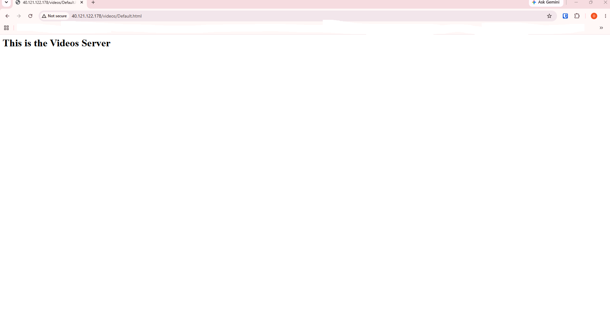

*Browser validation confirming HTTP traffic routed successfully to the Videos Server via Application Gateway.*
